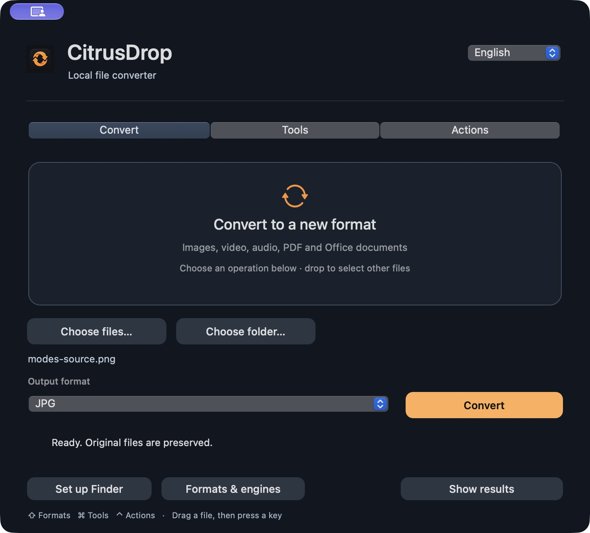

<p align="center"></p>

# CitrusDrop

Native macOS 13+ · Apple silicon & Intel · v0.2.0 · MIT

**Drop a file. Pick a format. Keep your originals.**

A free, open-source macOS converter for images, video, audio, PDFs, documents, spreadsheets and presentations. Native Swift / AppKit interface, a Finder format wheel, and English / Russian language selection.

[Download for Mac](https://github.com/C0mrade530/CitrusDrop/releases/latest) · [Русский](README.ru.md) · [Engine details](docs/ENGINES.md) · [MIT license](LICENSE)

No account, subscription, file quota, analytics or cloud conversion. Your files are processed on your Mac. Free media and office engines install from inside the app; Homebrew and Terminal are not required.



## Install

**macOS 13 or later · Apple silicon and Intel universal app**

Download [CitrusDrop.dmg](https://github.com/C0mrade530/CitrusDrop/releases/latest/download/CitrusDrop.dmg), open it, and drag CitrusDrop into Applications. Open the app and use **Formats & engines → Install free engines** for video, audio and Office support. Existing compatible engines can be reused.

Or install the app and its missing engines with one command:

```sh
curl -fsSL https://raw.githubusercontent.com/C0mrade530/CitrusDrop/main/install.sh | bash
```

The script installs into `~/Applications`, checks the release ZIP's SHA-256 and app signature, and keeps a dated backup when replacing an existing app. It does not quit a running app. You can review [install.sh](install.sh) first.

First engine setup downloads about **350–380 MB** and uses about **1 GB** of disk space. Allow **2 GB free** for installation. Subsequent conversions work offline. Engines are separate optional downloads with their own [licenses and provenance](docs/ENGINES.md).

Releases currently use an **ad hoc signature**, without Apple Developer ID notarization. macOS may require **System Settings → Privacy & Security → Open Anyway** after the first opening attempt. The installer keeps system protections intact. Managed Macs may require an administrator-approved build. [Apple's opening instructions](https://support.apple.com/en-us/102445).

For an app-only installation without opening the window:

```sh
curl -fsSL https://raw.githubusercontent.com/C0mrade530/CitrusDrop/main/install.sh | bash -s -- --app-only --no-open
```

## Use it from Finder

- **Drag + Shift:** start dragging files, press Shift, then drop onto a format. Command switches to tools; Control switches to file actions. Esc closes the wheel.
- **Right-click:** files → **Services → CitrusDrop — Convert…** or **CitrusDrop — Compress**. Click a sector or use arrow keys and Enter.
- **Tap Shift:** opt in through **Set up Finder → Enable Shift**. Tapping and releasing Shift on selected Finder files opens the wheel. macOS requests Finder Automation permission. Long holds and Shift-click selections do not trigger it.
- **App window:** select or drop files, choose a format or tool, and run the batch. Change English / Russian at the top right.

**Convert** changes the output format. **Tools** provides compression and editing. **Actions** handles copying, moving, AirDrop and preview. Each mode explains its purpose before you select files; the available operations appear after selection. Format/tool choices survive mode and language changes.


If Services are hidden, enable them under **System Settings → Keyboard → Keyboard Shortcuts → Services → Files and Folders**. This uses macOS Services; nesting depends on your settings. Grant access to your selected folders when macOS asks. The app stays in the menu bar when its window closes.

## Supported conversions

| Category | Formats and tools |
|---|---|
| Images | PNG, JPEG, HEIC, TIFF, BMP, GIF, WebP, AVIF, PDF; compression, resize, center crop, rotation, flip, grayscale, metadata removal |
| Video | MP4, MOV, MKV, WebM, GIF; audio extraction to MP3/M4A/WAV; compression, trimming, metadata removal |
| Audio | MP3, M4A, AAC, WAV, FLAC, OGG, Opus, AIFF; compression, trimming, metadata removal |
| PDF | Every page to PNG/JPEG; text-layer extraction; merge, split and compression |
| Documents | DOC, DOCX, ODT, RTF, HTML, TXT; document conversions, PDF/EPUB export, every page to PNG/JPEG |
| Spreadsheets | XLS, XLSX, ODS, CSV, TSV; PDF and page-image export |
| Presentations | PPT, PPTX, ODP; PDF and slide-image export |
| Text and subtitles | TXT/Markdown text exports; SRT ↔ VTT; subtitle text extraction |
| Archives | Create ZIP/TAR/TGZ; extract or repack formats supported by macOS bsdtar |
| File actions | Reveal, copy, copy path, duplicate, move, AirDrop, floating preview and Terminal |

Available formats depend on the selected file, macOS support and installed codecs. The app offers supported conversion pairs rather than every possible combination.

Results are saved beside the original files. Name collisions receive numbered suffixes. Originals are preserved; the explicit **Move** action changes file locations. Cancellation stops external processing or the next native stage; completed results remain.

## Practical limits

- Compression depends on the input. Already optimized files may not shrink. PDF compression uses the native Quartz filter, checks page count and text retention, and refuses a result that is not smaller. Re-encoding can change image, video or audio quality.
- Office layout depends on fonts and LibreOffice. PNG/JPEG exports create a folder with every page or slide. CSV/TSV exports contain the **first worksheet** and values rather than workbook structure and formulas.
- Markdown is literal text, without a Markdown layout renderer. EPUB is **export-only**. Importing EPUB, Pages and Keynote is unsupported; export Pages/Keynote to DOCX/PPTX first.
- No OCR or PDF-to-editable Word/Excel/PowerPoint. Scanned PDFs need OCR elsewhere before text extraction. Unlock password-protected documents first.
- Image conversion exports the first animation frame; editing tools reject animated images. Re-encoding removes source metadata and may affect color profiles.
- No SVG, annotations, redaction, collages or video editing timeline. Password-protected archives and standalone non-TAR GZIP are unsupported; RAR/7z depend on macOS bsdtar.
- The universal app contains both architectures. Apple silicon has been run-tested locally. Intel binaries have been built and inspected, without physical Intel Mac verification.

## Build and check

Free Apple Command Line Tools or Xcode with Swift 5.9+ are sufficient. No Swift Package Manager dependencies.

```sh
xcode-select --install
./scripts/build.sh
dist/CitrusDrop.app/Contents/MacOS/CitrusDrop --install-engines
./scripts/test.sh
./scripts/package.sh --universal
```

Tests use temporary fixtures and check real conversions, original preservation, name collisions, cancellation and archive safety. Media and office checks run when their engines are available. See [QA evidence and its scope](docs/QA.md).

```sh
dist/CitrusDrop.app/Contents/MacOS/CitrusDrop --convert mp4 '/path/to/video.mov'
dist/CitrusDrop.app/Contents/MacOS/CitrusDrop --convert pdf '/path/to/slides.pptx'
dist/CitrusDrop.app/Contents/MacOS/CitrusDrop --perform compress '/path/to/photo.jpg'
```

The [public workflow](.github/workflows/macos.yml) checks conversions on `macos-latest`, builds the universal app, and retains DMG/ZIP/checksum artifacts. A `v*` tag publishes tested artifacts as a GitHub Release using the repository's automatic token. GitHub's own Actions terms and limits apply.

CitrusDrop is an independent implementation inspired by quick file-conversion workflows. It contains no Tangerine code or graphics and is not affiliated with that product. [Research](docs/RESEARCH.md) · [Engines](docs/ENGINES.md) · [License](LICENSE)
