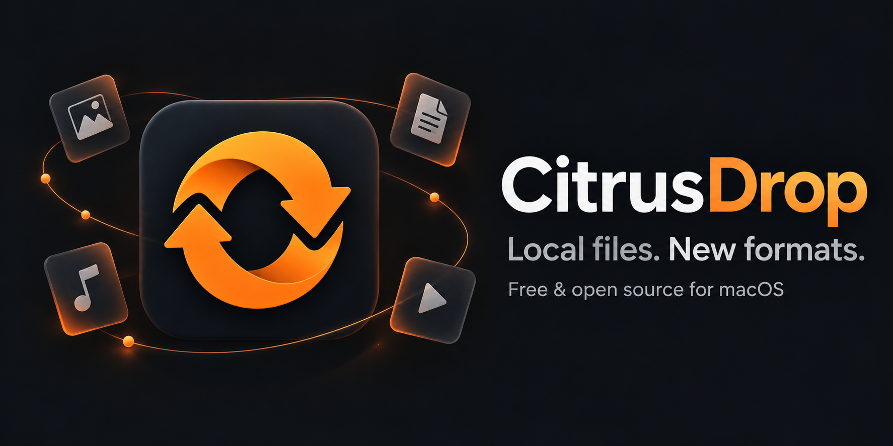
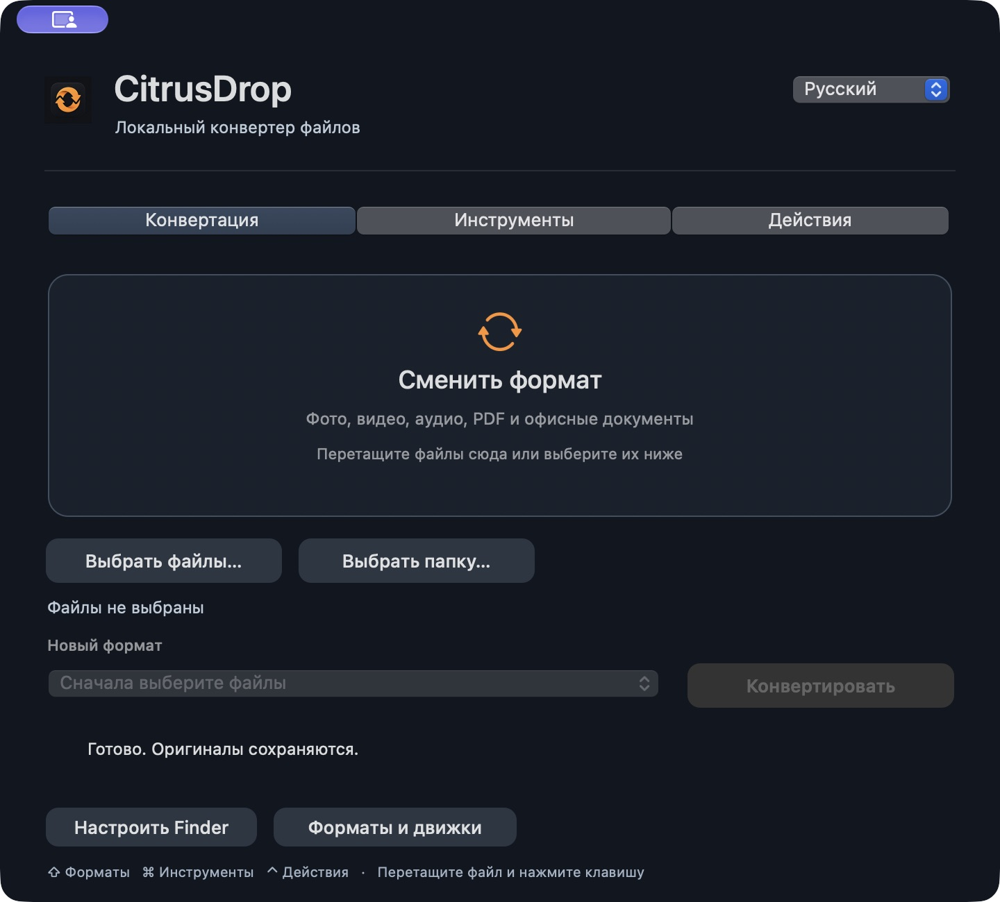
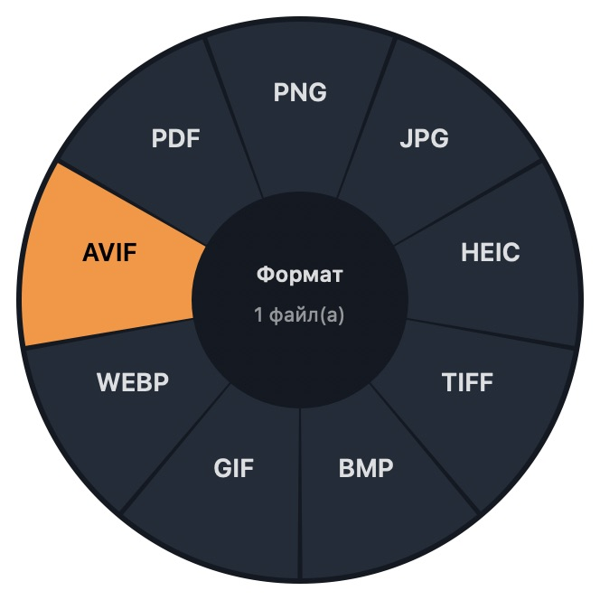

<p align="center"></p>

# CitrusDrop

macOS 13+ · Apple silicon и Intel · v0.2.0 · MIT

**Перетащите файл. Выберите формат. Сохраните оригинал.**

Бесплатный конвертер с открытым исходным кодом для macOS: изображения, видео, аудио, PDF, документы, таблицы и презентации. Нативный интерфейс Swift / AppKit, колесо форматов в Finder и выбор русского или английского языка.

[Скачать для Mac](https://github.com/C0mrade530/CitrusDrop/releases/latest) · [English](README.md) · [Движки и лицензии](docs/ENGINES.md) · [Лицензия MIT](LICENSE)

Без аккаунтов, подписки, лимитов на файлы, аналитики и облачной конвертации. Обработка идёт на вашем Mac. Бесплатные движки медиа и Office устанавливаются из приложения — Homebrew и Терминал для этого не нужны.



## Установка

**macOS 13 и новее · universal-приложение для Apple silicon и Intel**

Скачайте [CitrusDrop.dmg](https://github.com/C0mrade530/CitrusDrop/releases/latest/download/CitrusDrop.dmg), откройте образ и перенесите приложение в «Программы». Откройте CitrusDrop и выберите **Форматы и движки → Установить бесплатные движки**, чтобы добавить видео, аудио и Office. Уже установленные совместимые движки можно использовать повторно.

Или установите приложение и недостающие движки одной командой:

```sh
curl -fsSL https://raw.githubusercontent.com/C0mrade530/CitrusDrop/main/install.sh | bash
```

Скрипт устанавливает приложение в `~/Applications`, проверяет SHA-256 ZIP и подпись приложения. При обновлении сохраняет прежнюю версию в резервную копию с датой. Работающее приложение он не завершает. При желании сначала прочитайте [install.sh](install.sh).

Первая установка движков скачивает около **350–380 МБ** и занимает примерно **1 ГБ**. Для установки нужно **2 ГБ свободного места**. Затем конвертация работает без интернета. Движки скачиваются отдельно; их [происхождение и лицензии](docs/ENGINES.md) описаны отдельно.

Релизы пока имеют локальную **ad hoc подпись**, без Apple Developer ID и нотариализации. После первой попытки запуска macOS может потребовать **Системные настройки → Конфиденциальность и безопасность → Всё равно открыть**. Скрипт сохраняет системную защиту. На рабочем управляемом Mac может потребоваться сборка, одобренная администратором. [Инструкция Apple](https://support.apple.com/en-us/102445).

Установка только приложения, без движков и открытия окна:

```sh
curl -fsSL https://raw.githubusercontent.com/C0mrade530/CitrusDrop/main/install.sh | bash -s -- --app-only --no-open
```

## Работа из Finder

- **Перетаскивание + Shift:** начните тянуть файлы, нажмите Shift и отпустите их над форматом. Command переключает инструменты, Control — файловые действия. Esc закрывает колесо.
- **Правая кнопка:** файлы → **Службы → CitrusDrop — Конвертировать…** или **CitrusDrop — Сжать**. Выберите сектор мышью либо стрелками и Enter.
- **Короткое нажатие Shift:** включите **Настроить Finder → Включить Shift**. Нажатие и отпускание Shift на выделенных файлах откроет колесо. macOS запросит управление Finder. Долгое удержание и выделение мышью с Shift не запускают этот режим.
- **Окно приложения:** выберите или перетащите файлы, укажите формат или инструмент, запустите пакет. Язык меняется справа вверху.

**«Конвертация»** меняет формат. **«Инструменты»** — сжатие и обработка. **«Действия»** — копирование, перемещение, AirDrop и просмотр. У каждого режима своё пояснение; после выбора файла появляется список доступных операций. Выбранный формат и инструмент сохраняются при смене режима и языка.



Если службы не видны, включите их в **Системные настройки → Клавиатура → Сочетания клавиш → Службы → Файлы и папки**. Используется стандартное меню Services; вложенность зависит от настроек macOS. Разрешите доступ к выбранным папкам, если система его запросит. После закрытия окна приложение остаётся в строке меню.

## Возможности

| Категория | Форматы и инструменты |
|---|---|
| Изображения | PNG, JPEG, HEIC, TIFF, BMP, GIF, WebP, AVIF, PDF; сжатие, размер, центральная обрезка, поворот, отражение, чёрно-белое, удаление метаданных |
| Видео | MP4, MOV, MKV, WebM, GIF; извлечение MP3/M4A/WAV; сжатие, обрезка по времени, удаление метаданных |
| Аудио | MP3, M4A, AAC, WAV, FLAC, OGG, Opus, AIFF; сжатие, обрезка по времени, удаление метаданных |
| PDF | Все страницы в PNG/JPEG; извлечение текстового слоя; объединение, разделение, сжатие |
| Документы | DOC, DOCX, ODT, RTF, HTML, TXT; офисные преобразования, экспорт PDF/EPUB, все страницы в PNG/JPEG |
| Таблицы | XLS, XLSX, ODS, CSV, TSV; экспорт в PDF и изображения страниц |
| Презентации | PPT, PPTX, ODP; экспорт в PDF и изображения слайдов |
| Текст и субтитры | Текстовые экспорты TXT/Markdown; SRT ↔ VTT; реплики в TXT |
| Архивы | Создание ZIP/TAR/TGZ; распаковка и перепаковка форматов системного bsdtar |
| Файлы | Finder, копирование, путь, дубликат, перемещение, AirDrop, плавающий просмотр, Терминал |

Форматы зависят от выбранного файла, macOS и кодеков. Приложение предлагает поддерживаемые пары преобразований.

Результаты создаются рядом с оригиналами. Совпадение имени добавляет числовой суффикс. Оригиналы сохраняются; действие **«Переместить»** явно меняет расположение файла. Отмена прерывает внешний процесс или следующий нативный этап; готовые результаты остаются.

## Ограничения

- Уже оптимизированный файл может не уменьшиться. Сжатие PDF использует системный фильтр Quartz, проверяет число страниц и сохранность текста, отвергает результат без уменьшения. Перекодирование может менять качество фото, видео и аудио.
- Офисная вёрстка зависит от шрифтов и LibreOffice. PNG/JPEG создаёт папку со всеми страницами или слайдами. CSV/TSV содержит **первый лист** и значения вместо структуры книги и формул.
- Markdown обрабатывается как обычный текст. EPUB доступен **для экспорта**. Импорт EPUB, Pages и Keynote не поддерживается; Pages/Keynote сначала экспортируйте в DOCX/PPTX.
- Нет OCR и PDF → редактируемый Word/Excel/PowerPoint. Для извлечения текста из сканов сначала нужен OCR в другом приложении. Защищённые документы разблокируйте перед конвертацией.
- Конвертация анимированного изображения сохраняет первый кадр; инструменты редактирования отвергают анимации. Перекодирование удаляет метаданные и может менять цветовой профиль.
- Нет SVG, разметки, цензуры, коллажей и монтажной шкалы. Парольные архивы и одиночный GZIP без TAR не поддерживаются; RAR/7z зависят от macOS bsdtar.
- Сборка содержит обе архитектуры. Запуск проверен на Apple silicon; Intel собран и проверен по составу бинарников, без проверки на физическом Intel Mac.

## Сборка и проверка

Достаточно бесплатных Apple Command Line Tools либо Xcode со Swift 5.9+. Внешних SwiftPM-зависимостей нет.

```sh
xcode-select --install
./scripts/build.sh
dist/CitrusDrop.app/Contents/MacOS/CitrusDrop --install-engines
./scripts/test.sh
./scripts/package.sh --universal
```

Проверки используют временные файлы: реальные преобразования, сохранность оригиналов, совпадения имён, отмена, безопасность архивов. Медиа- и офисные случаи запускаются при наличии движков. [Результаты и границы проверки](docs/QA.md).

```sh
dist/CitrusDrop.app/Contents/MacOS/CitrusDrop --convert mp4 '/путь/видео.mov'
dist/CitrusDrop.app/Contents/MacOS/CitrusDrop --convert pdf '/путь/презентация.pptx'
dist/CitrusDrop.app/Contents/MacOS/CitrusDrop --perform compress '/путь/фото.jpg'
```

[Публичный workflow](.github/workflows/macos.yml) проверяет конвертацию на `macos-latest`, собирает universal-приложение и сохраняет DMG/ZIP/контрольные суммы. Тег `v*` публикует прошедшие проверки артефакты в GitHub Release со стандартным токеном репозитория. Действуют условия и лимиты GitHub Actions.

CitrusDrop — самостоятельная реализация сценария быстрой конвертации. Код и графика Tangerine не используются; связи с продуктом нет. [Исследование](docs/RESEARCH.md) · [Движки](docs/ENGINES.md) · [Лицензия](LICENSE)
